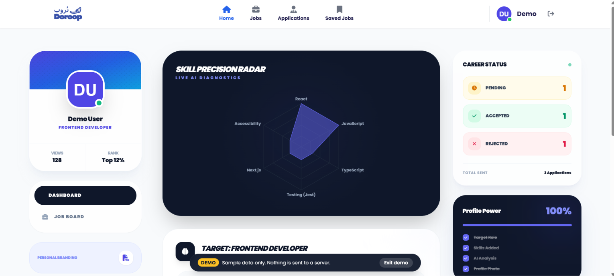

# Doroop – Job Platform (Frontend)

A job-board web app that connects **job seekers** and **companies**. Job seekers build a profile, upload a CV, search jobs by skill and apply; companies post vacancies and review applicants. The app also analyses a user's CV/skills and suggests a learning roadmap.

> Graduation project built by a two-person team. This repository contains the **React frontend**; it talks to a **.NET REST API** built by my teammate.

| | |
|---|---|
| **Live demo** | [ADD VERCEL LINK] |
| **Backend (.NET API)** | [ADD BACKEND REPO LINK] – built by [TEAMMATE NAME] |
| **My role** | Frontend: UI, routing, auth flow, API integration, state management |

<!-- Add 3–4 screenshots or a short GIF here, e.g.  -->

## Features

**Job seekers**
- Sign up with email verification, log in, and reset a forgotten password with an emailed code
- Browse jobs, search by skill and filter by job type and experience level
- Apply to a job by uploading a CV, then track, review and withdraw applications
- Profile page: edit info, upload an avatar, manage skills, upload a CV for automatic analysis
- Dashboard with a skill radar chart, AI skill-gap analysis and a learning roadmap
- Save jobs for later

**Companies**
- Create a company profile with a logo
- Company dashboard: post, edit and delete job vacancies
- View the applicants for each job and inspect their applications

**Under the hood**
- JWT authentication with **automatic access-token refresh** (a single shared refresh request for parallel 401s)
- Protected routes with loading skeletons
- One shared Axios client (`src/Api/apiClient.js`) for every request
- Toast notifications (small dependency-free helper) instead of `alert()`

## Tech stack

React 18 (Create React App) · React Router 6 · Tailwind CSS 3 · Axios · Framer Motion · Recharts · Font Awesome

## Getting started

```bash
git clone [ADD REPO URL]
cd [REPO FOLDER]
npm install
npm start          # http://localhost:3000
```

No `.env` file is needed. In development, requests to `/api/...` are forwarded to the hosted backend by the `"proxy"` field in `package.json`, so you will not run into CORS errors.

To use a different backend, change `"proxy"` in `package.json` (development) and the destination in `vercel.json` (production). See `.env.example` for the optional `REACT_APP_API_ROOT` override.

```bash
npm run build      # production build in /build
```

## Deploying to Vercel

1. Push the repo to GitHub and import it in Vercel (the Create React App preset is detected automatically).
2. Deploy. No environment variables are required.

`vercel.json` does two things:
- **Proxies `/api/*` to the backend**, so the browser only ever talks to the frontend's own domain (no CORS configuration needed on the server).
- **Falls back to `index.html`** for every other path, so deep links like `/home` or `/job/12` work on refresh.

## Project structure

```
src/
├── Api/          # Axios client + one service file per backend resource
├── components/   # Navbar, sidebars, job card, skeletons, toaster, route guard…
├── context/      # Auth (verification flow), User (session) and Job (list + saved jobs) contexts
├── pages/        # One file per screen / route
└── utils/        # session helper and toast helper
```

## Demo accounts

| Role | Email | Password |
|---|---|---|
| Job seeker | [ADD] | [ADD] |
| Company | [ADD] | [ADD] |

## Known limitations

- **Saved jobs** are stored in the browser's `localStorage` (not synced across devices); they are cleared on logout.
- The **Company Settings** page is a UI prototype with mock data; it is hidden from the navigation until it is connected to the API.
- Auth tokens live in `localStorage`; `httpOnly` cookies would be more resistant to XSS.
- No automated tests yet.
- The app depends on the hosted backend; if the API is down, data will not load.
